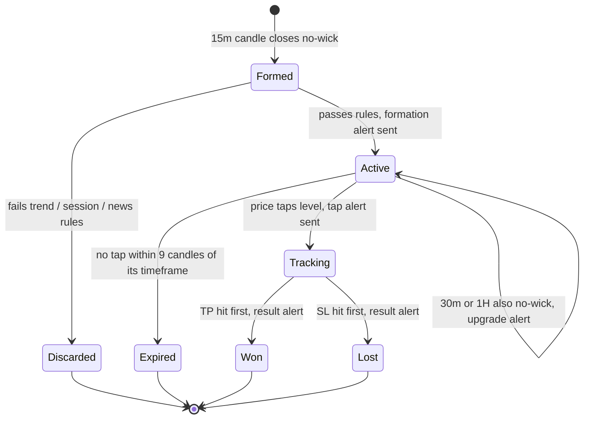

# No-Wick Alert Bot — Requirements

## Summary

A free bot, run by GitHub's scheduled jobs, that reads TradingView's OANDA AUDUSD and GBPUSD candles and finds no-wick candles on the 15m (upgrading a setup when the 30m or 1H also closes no-wick). It checks BardFX's mechanical rules (15m body-close BOS trend, 4H alignment or two BOS, sessions, news) and sends Telegram alerts when a valid level forms, when price taps it within 9 candles, and when the suggested TP or SL hits, plus a weekly win-rate recap. Alerts only; no orders are placed, and it costs nothing to run.

---

## Problem Frame

The trader runs BardFX's "nowick" 1:1 entry model by hand on OANDA charts in TradingView. They have backtested it extensively (roughly 70–80% win rate) and trust the rules. The model only works if you catch a no-wick level as it forms and are around when price returns to it, usually within a few candles. TradingView alerts on the X Ghost Wickless Candles indicator need a paid plan, so today the only option is watching charts through the session. Bard himself trades from phone alerts and checks each one by hand. This bot gives the same freedom, with the mechanical rule checks done before the phone buzzes. The trader's computer must be able to stay off, and the whole setup must be free.

---

## Key Decisions

- **$0 to run.** No paid servers, data or subscriptions. This decides the data source and hosting below and accepts their trade-offs.
- **TradingView's OANDA feed as the price source.** Candles are read from TradingView through the community TradingView-API library, with no login. Tested 2026-11-04: the feed is live (latest 1m candle about 25 seconds old), gives 500 candles on the 30m, 1H and 4H, and its no-wicks matched X Ghost on the trader's chart. It is unofficial and against TradingView's terms for automated access, so it can be blocked or break when TradingView changes its site. The trader accepted that risk. OANDA's own API was ruled out because it isn't offered to the trader's OANDA division (OANDA Global Markets).
- **GitHub Actions as the host.** A scheduled job runs about every 15 minutes in a public repository, which gets unlimited free minutes; secrets stay encrypted. Scheduled jobs can start 5–15+ minutes late, so alerts are not instant. Each run checks every 1-minute candle since the previous run, so no tap or TP/SL hit is missed, only reported late. Late formation alerts are workable because entry is a limit order at the level.
- **Alert on valid setups only, then follow up.** A level is only sent if it already passes the mechanical rules; a second alert fires on the tap. Fewer alerts, each worth opening.
- **Bard's full trend rule, not an EMA.** Direction comes from body-close market structure on the 15m (internal) and 4H (external), including the two-BOS rule when trading against the 4H. The originally floated EMA filter is dropped because the model doesn't use one.
- **Voids and other soft rules are warnings, not filters.** Unfilled voids against the trade, conflicting no-wicks, late-trend setups, oversized stops and TP blocked by structure are flagged in the alert. Their detection is approximate, and silently dropping trades on a misread is worse than an extra line of text.
- **Red-folder news mutes alerts.** No formation or tap alerts in a window around high-impact events for the pair's currencies.
- **Tracking scores the structure-based stop, conservatively.** Bard rates both stop methods as similar; structure-based is his primary and is the one scored. The previous-candle stop is shown as an alternative. If TP and SL fall inside the same 1-minute candle, the result counts as a loss.

---

## Level Lifecycle

---

## Requirements

**Detection**

- R1. A bullish no-wick is a candle that closes above its open with open equal to low. A bearish no-wick closes below its open with open equal to high. The level is the candle's open price.
- R2. Detection runs on AUDUSD and GBPUSD on the 15m, 30m and 1H using TradingView's OANDA candles, and reproduces what X Ghost Wickless Candles shows on those charts.
- R3. When the 30m or 1H candle containing a 15m no-wick also closes as a no-wick at the same level, the setup is upgraded. Each qualifying higher timeframe sends its own "upgraded" follow-up as soon as its candle closes (at most two: 30m, then 1H), never a duplicate formation alert. Each upgrade re-bases the tap window, stops and TP on that timeframe.
- R4. Candle-close times decide the rules, not the time a run happens to start. A late run evaluates candles exactly as an on-time run would have.

**Trend and validity rules**

- R5. Internal trend is read on the 15m from swing highs and lows measured on candle bodies (closes and opens, not wicks), at the most sensitive pivot setting (equivalent to "Higher High Lower Low" by LonesomeTheBlue at period 2). A BOS is a body close beyond the most recent swing; trend direction is the direction of the most recent BOS. Doji candles do not count as structure.
- R6. External trend is read the same way on the 4H.
- R7. A setup is valid only when the no-wick direction matches the internal trend and one of two conditions holds:
  - (a) the external trend agrees, and there is at least one BOS in that direction on the 15m; or
  - (b) the external trend disagrees, and the 15m shows two consecutive BOS in the trade direction.
- R8. Alerts are sent only for setups that form during late Asia, London or NY, excluding the NY open, the first three hours of Asia, and late NY before close. Session windows are configurable in one place.
- R9. No formation or tap alerts are sent for setups whose candle closes, or whose tap happens, from about 30 minutes before to 30 minutes after a high-impact (red-folder) event for either currency in the pair.

**Trade levels**

- R10. Entry is the level. The suggested stop is beyond the most recent swing before the no-wick, plus a small buffer. The previous non-doji candle's high or low is shown as an alternative stop. TP is 1:1 from entry against the suggested stop.

**Warnings shown in the alert (never filters)**

- R11. Flag an unfilled void (a run of mostly same-color candles price has not retraced through) sitting against the trade, with its price range.
- R12. Flag a conflicting no-wick: an untapped opposite-direction level between stop and TP.
- R13. Flag when TP lies beyond an opposing swing high or low (Bard's "pull TP in" case), and when the stop is unusually large. Show the BOS count in the current trend so early vs late trend is visible.
- R14. Note any red-folder event for the pair's currencies in the next two hours.

**Alerts**

- R15. Formation alert contents:
  - pair, timeframe, direction and entry
  - suggested stop, alternative stop, TP and risk in pips
  - internal and external trend, with BOS count
  - session
  - the time the 9-candle tap window closes
  - any warnings
- R16. Tap alert: sent on the first run after price touches an active level inside its 9-candle window, stating when the touch happened and the candle count (e.g., 2/9). A tap after the window does not alert; the level expires silently.
- R17. Result alert: when a tapped setup hits TP or SL first, report the outcome (+1R or −1R) and when it happened.
- R18. Weekly recap after the Friday close: alert count, wins, losses and win rate, broken down by pair and timeframe.
- R19. All messages go to the trader's Telegram through a private bot. No orders are ever placed.

**Reliability**

- R20. Runs for $0 on GitHub's scheduled jobs, with the trader's computer off, through the forex week.
- R21. Each alert is sent once, even if runs overlap, retry or start late.
- R22. Silence must never be ambiguous. If a run fails, TradingView stops returning data, or Telegram rejects a message, the trader is told. A daily "running" check-in makes a fully stopped bot noticeable.
- R23. The schedule must not lapse from inactivity. GitHub disables schedules in public repositories after 60 days without activity, and the bot's routine state saves must keep the repository active.

---

## Acceptance Examples

- AE1. **Covers R7.** Given 4H bullish and 15m bullish with one bullish BOS, when a bullish 15m no-wick closes in London, a formation alert is sent.
- AE2. **Covers R7.** Given 4H bearish and 15m bullish with only one bullish BOS, when a bullish no-wick closes, no alert is sent. After a second consecutive bullish BOS, the next bullish no-wick alerts.
- AE3. **Covers R16.** Given an active 15m level, when price first touches it on the 10th candle after formation, no tap alert is sent and the level is not tracked.
- AE4. **Covers R9.** Given USD CPI at 13:30 UTC, when a valid GBPUSD no-wick closes at 13:15 UTC, no alert is sent.
- AE5. **Covers R3.** Given a bullish 15m no-wick alerted at 09:00, when the 09:00 30m candle also closes no-wick, an "upgraded to 30m" follow-up is sent and the tap window becomes 9 × 30m candles.
- AE6. **Covers R11.** Given a valid bullish setup with an unfilled bullish push below the entry (price hasn't come back down to fill it, so it pulls price toward the stop), the alert is still sent with a void warning and its range. An unfilled bearish push above the entry pulls price toward TP and is not a warning.
- AE7. **Covers R4, R16.** Given a level formed at 10:00 and a scheduled run that starts 14 minutes late, when the 1-minute candles show a touch at 10:31, the tap alert says "tapped 10:31, 2/9" and tracking starts from 10:31.

---

## Success Criteria

- During a 1–2 week calibration period, the bot's no-wicks keep matching X Ghost Wickless Candles on TradingView's OANDA AUDUSD and GBPUSD charts, and its trend/BOS reads agree with the trader's own read on the large majority of alerts. Mismatches are reviewed and the swing settings tuned.
- Most alerts arrive within a few minutes of the event, and none are missed. Occasional 15+ minute delays from GitHub's scheduler are acceptable.
- No silent outages: every gap in alerts is explained by rules, sessions, news or a reported failure.
- After a month, the tracked win rate is a usable comparison against the trader's backtests.
- Running cost stays at $0.

---

## Scope Boundaries

**Deferred for later**

- Trade-management alerts: Bard moves the stop to break-even when an opposite no-wick forms during a trade (or TP to break-even if in drawdown). This is mechanical and cheap to add once tracking exists.
- Chart screenshots in alerts.
- More pairs or futures.
- A historical backtest engine.
- Seconds-fast tap alerts, which would need an always-on host and conflict with the $0 constraint.

**Outside this bot's identity**

- Automatic order placement.
- The discretionary parts of the model. The alert surfaces the information; the trader decides:
  - pre-entries (Gann-box or retest entries when the no-wick is deep in the leg)
  - range and decision-area trades
  - imbalance-based overrides and TP beyond 1:1
  - actually pulling TP in
- Prop-firm account rotation.
- EMA or other indicator filters.
- Paid hosting or paid data.

---

## Dependencies / Assumptions

- A free GitHub account and a public repository for the bot.
- A Telegram bot created through BotFather, plus the trader's chat ID.
- A free economic-calendar feed covering USD, AUD and GBP red-folder events.
- The community TradingView-API library keeps working. If anonymous access becomes limited, the fallback is the trader's free TradingView account session, stored as a GitHub secret.
- Assumption: TradingView serves data to GitHub's servers the same way it does to a home PC. This is unverified until the first scheduled run.
- Assumption: Bard's 15m internal / 4H external pairing applies to upgraded 30m and 1H setups too.

---

## Outstanding Questions

**Deferred to planning**

- Confirm on the first GitHub run that TradingView isn't blocked or limited from GitHub's servers. If it is, pick the fallback (logged-in session, or a different free host such as a spare phone).
- Exact session windows in UTC, including daylight-saving shifts, for "late Asia", "NY open" and "late NY".
- The swing-pivot sensitivity and doji threshold that best reproduce the trader's and LonesomeTheBlue's structure reads.
- Stop buffer size, the "unusually large stop" threshold, and the void-detection heuristic.
- Schedule frequency and run length that keep the bot inside GitHub's limits.

---

## Sources

- BardFX, "the 90% win rate strategy that made me $800k (full breakdown)" — https://www.youtube.com/watch?v=4Xg5XSa0Kx4 (entry model, trend reading, alignment, timeframe priority, sessions, stops, TP, management, avoid list)
- BardFX, "TRADING FREE COURSE | Imbalances" — https://www.youtube.com/watch?v=pO9ZybSPxxk (void/imbalance definition and extent)
- TradingView-API (community, unofficial) — https://github.com/Mathieu2301/TradingView-API (candle source; v4.1.1 tested)
- OANDA v20 API availability — https://developer.oanda.com/rest-live-v20/introduction/ (not offered to OANDA Global Markets or OANDA TMS Brokers)
- TradingView indicators referenced: X Ghost Wickless Candles (closed source; rule reproduced from its stated behavior), Higher High Lower Low by LonesomeTheBlue.
