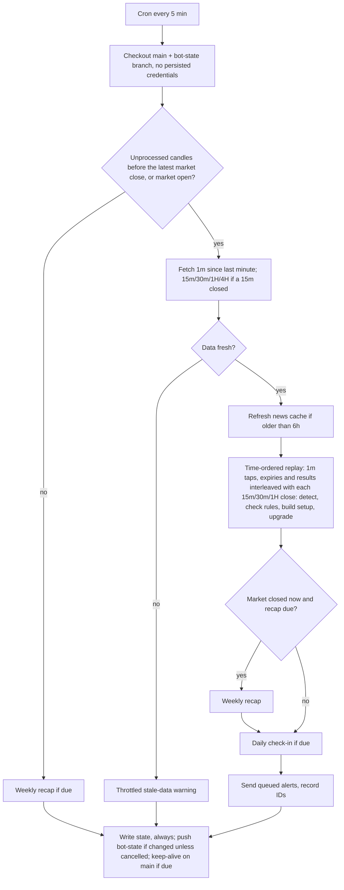

# feat: No-wick alert bot on GitHub Actions

## Summary

A small Node.js bot that a GitHub Actions schedule runs every 5 minutes. Each run:
- reads TradingView's OANDA AUDUSD and GBPUSD candles
- applies BardFX's no-wick, structure, session and news rules
- follows active levels through tap and TP/SL using 1-minute candles
- sends the resulting alerts to Telegram

State lives in a JSON file on a separate branch. Running cost is $0.

---

## Problem Frame

The trader trades BardFX's no-wick 1:1 model from TradingView OANDA charts and needs phone alerts, under three constraints (see origin: `docs/brainstorms/2026-11-04-nowick-alert-bot-requirements.md`):
- TradingView's own alerts need a paid plan.
- The computer must be able to stay off.
- Nothing may cost money.

The repository is empty, so there are no local patterns to follow. The plan is greenfield and leans on three external pieces verified during planning: the TradingView-API library, the ForexFactory calendar feed, and GitHub Actions scheduling.

---

## Requirements

Origin requirements carry forward with their IDs. Three are knowingly adjusted:
- R3 allows up to two upgrade follow-ups (30m, then 1H).
- R21 accepts at most one repeat of a single run's alerts after a crash mid-run.
- R23 is met by keep-alive commits on `main`, not by routine state saves.

**Detection**
- R1. A bullish no-wick has close > open and open = low; a bearish one has close < open and open = high. The level is the open.
- R2. Detect on AUDUSD and GBPUSD, on the 15m, 30m and 1H, from TradingView's OANDA candles.
- R3. Upgrade when the containing 30m or 1H candle is also a no-wick at the same level. Send one follow-up per qualifying higher timeframe (at most two), and re-base the tap window, stops and TP each time.
- R4. Evaluate by candle-close time, never by run time.

**Rules**
- R5. Internal trend: 15m swings measured on candle bodies, BOS on a body close, dojis ignored.
- R6. External trend: the same method on the 4H.
- R7. Validity: either aligned with the 4H plus one BOS, or against the 4H plus two consecutive BOS.
- R8. Session filter (late Asia, London, NY, minus the excluded windows), configurable.
- R9. Mute from 30 minutes before to 30 minutes after red-folder news.

**Trade levels and warnings**
- R10. Structure stop plus buffer, a previous-candle alternative stop, and a 1:1 TP.
- R11–R14. Warnings, never filters:
  - R11. A void against the trade.
  - R12. A conflicting no-wick.
  - R13. TP beyond an opposing swing, a large stop, and the BOS count.
  - R14. News in the next 2 hours.

**Alerts**
- R15–R18. Formation, tap, result and weekly-recap messages.
- R19. Telegram only; no orders.

**Reliability**
- R20. $0 on GitHub Actions, with the computer off.
- R21. Each alert sent once, except for the adjustment noted above.
- R22. Failures reported, plus a daily check-in.
- R23. The schedule must not lapse from inactivity.

Origin acceptance examples AE1–AE7 are enforced by the test scenarios below.

---

## Key Technical Decisions

- **Plain JavaScript (ES modules) on Node 22, `node:test`, no build step.** The only direct runtime dependency is `@mathieuc/tradingview`, pinned to an exact version (4.1.1 tested) because it tracks an unofficial protocol.
- **Locked, script-free installs.** `package-lock.json` is committed, and CI installs with `npm ci --ignore-scripts`. This pins every transitive dependency, and nothing runs at install time (the bot needs no native builds). Any dependency change, direct or transitive, is a deliberate lockfile change, checked with a calibration run before merging.
- **Pure rule functions over plain candle arrays; I/O at the edges.**
  - Pure (take candles, state and a clock; return results): detection, structure, validity, levels, warnings, sessions, lifecycle.
  - Touch the network or disk: only the candle source, news fetch, Telegram and the state file.
  - Result: every rule is testable with made-up candles, and a late run behaves exactly like an on-time one (R4).
- **Time model.**
  - Internally, everything is UTC Unix seconds. A candle's `time` is its open; its close is `time + timeframe`.
  - Session rules use IANA zones (`Asia/Tokyo`, `Europe/London`, `America/New_York`) through `Intl`, so daylight saving needs no hand-coded tables.
  - Messages show `Africa/Johannesburg` time.
  - Market week: Sunday 17:00 to Friday 17:00, New York time.
- **One time-ordered replay per run.**
  - The cron runs every 5 minutes, GitHub's minimum.
  - Each run merges two event streams in time order: 1m candles since the last processed minute (fetched with the library's `from` range option), and 15m/30m/1H closes since the last processed 15m close.
  - Before processing any higher-timeframe close, all 1m candles up to that close have already been replayed. Detection and upgrade checks therefore always see taps that happened earlier.
  - Late or dropped runs only delay alerts; they never change them.
- **Fresh state starts at "now".** With no state (first run, or a corrupt file reset), the last processed 15m and 1m times are set to the newest closed candles. Earlier candles are used only as history for structure, never as alert triggers.
- **Tap windows count market candles.** A level's tap deadline and its "n/9" count are measured in candles of the level's timeframe that fall inside market hours, skipping the weekend closure. A Friday 1H level can still be tapped after Sunday's open. "n" is the 1-based index of the timeframe candle, after the no-wick close, that contains the tap. Example: a 15m level opening 10:00 (closing 10:15) tapped at 10:31 is 2/9.
- **Taps and results from 1-minute candles, conservatively.**
  - A tap is the first 1m candle inside the window whose low (long) or high (short) reaches the level.
  - In the tap minute, only the stop is checked. TP checking starts the next minute, so a wide tap minute can't score a win that never happened.
  - In any later minute where both stop and TP are reached, the stop wins and the trade is a loss (origin decision).
- **Data gaps are reported, never guessed.** If the returned 1m history doesn't reach back to the last processed minute, ignoring expected market closures (the weekend and the daily 17:00 New York rollover break), affected levels resolve as "unknown (data gap)" and the alert says so.
- **Swings: body pivots, two bars each side, dojis skipped.**
  - A swing high is a non-doji candle whose body top is higher than the two non-doji candles on each side; swing lows mirror this. This matches LonesomeTheBlue's HHLL indicator at period 2.
  - A pivot counts only once its two right-hand candles have closed, so there's no look-ahead.
  - Default doji threshold: body under 10% of the candle's range.
  - BOS: a close beyond the most recent confirmed swing's body level. The trend is the direction of the latest BOS; the BOS count is the number of consecutive same-direction BOS.
  - Each run computes structure from a fixed window of the latest 500 bars, so late and on-time runs see the same history.
- **Trend checks always use the 15m (internal) and 4H (external)**, including for upgraded 30m and 1H setups (origin assumption).
- **Stops and TP.**
  - Structure stop: the wick extreme of the most recent confirmed opposite swing before the no-wick, plus a buffer (default 1.0 pip).
  - Alternative stop: the previous non-doji candle's extreme.
  - TP = entry + (entry − structure stop). This one formula works for both longs and shorts.
  - Pip = 0.0001 for both pairs.
  - On an upgrade, both stops are recomputed from the upgraded timeframe's swings and candles, and TP, risk and warnings are recomputed from them.
- **Upgrade policy.**
  - A 15m level can upgrade at the 30m close and again at the 1H close. Each sends its own follow-up (at most two), as soon as the information exists.
  - "Tapped before the higher candle closed" is decided from the 1m candles between the level's close and that higher candle's close.
  - A tapped level never upgrades.
- **Warning heuristics: simple defaults, tuned during calibration.** All thresholds live in config.
  - Void against a long: an unfilled bullish push below entry, i.e. a run of at least 5 candles with at most one opposite-color candle. The zone spans the run's first open to its last close, and it counts as unfilled until price trades back to the run's first open. Shorts mirror this.
  - Conflicting no-wick: an untapped opposite-direction no-wick from the last 20 15m candles that lies between stop and TP.
  - TP beyond structure: a confirmed opposing swing sits between entry and TP.
  - Large stop: over 20 pips (configurable).
- **News fails open, visibly.**
  - Source: the ForexFactory weekly feed (`nfs.faireconomy.media/ff_calendar_thisweek.json`), fetched at most every 6 hours and cached in state.
  - Events with `impact == "High"` for the pair's currencies count as red-folder.
  - If the feed is unreachable, alerts still go out, with a "news check unavailable" line.
- **Default sessions** (configurable, local market time):
  - Late Asia: from Tokyo 12:00 (3 hours after the 09:00 open) until London 08:00.
  - London: 08:00–17:00.
  - New York: 08:00–17:00, excluding the NY open (New York 08:00–10:00) and late NY (New York 15:00–17:00).
  - In SAST during the northern winter, that allows alerts 05:00–15:00 and 17:00–22:00.
  - The session filter applies at formation only. Tap alerts for an already-valid level are sent even after its session ends.
- **State on a separate branch.**
  - One JSON file on a `bot-state` branch holds: active levels, tracked trades, sent-alert IDs, results log, last processed times, news cache, and warning throttles.
  - The workflow checks it out into a subfolder, runs the bot, and commits only when the file changed. `main` stays clean.
  - The file never contains the chat ID, tokens or message bodies.
- **Public repo, knowingly.** Free unlimited minutes require a public repo, so the `bot-state` branch and Actions logs are world-readable: levels, trades and results. Logs print only counts and event IDs. The setup guide says this plainly.
- **Keep the schedule alive.** GitHub disables schedules in public repos after 60 days with no activity. When the last commit on `main` is more than 30 days old, the workflow refreshes a small keep-alive file on `main`. Whether `bot-state` commits count as activity is not relied on.
- **Exactly-once alerts.**
  - Each alert has a deterministic ID (`pair:tf:candleOpen:kind`).
  - IDs are recorded as messages succeed.
  - The bot writes state before any exit, including failures. The state push step runs unless the run was cancelled.
  - The workflow `concurrency` group uses `cancel-in-progress: false`. GitHub keeps at most one pending run and cancels older pending ones. That's harmless, because each run replays from state, but cancelled runs will appear in the history.
  - The remaining risk is a hard crash between a send and the state write, which can repeat at most that run's alerts once.
- **Telegram errors.**
  - 429: retried after `retry_after`.
  - 5xx: retried once, then the run fails, after saving state.
  - Any other 4xx (e.g. a message Telegram can't parse) is permanent: the event is marked failed, a short plain-text error notice is sent, and it's never retried.
- **Failure reporting has four layers.**
  - In-script Telegram warnings, each throttled to once per hour: stale TradingView data during market hours, an empty feed, news unavailable.
  - A workflow `if: failure()` step that posts to Telegram, using the token from `env`.
  - GitHub's own failed-run email, which covers Telegram itself being down.
  - A daily 05:00 SAST check-in on market days.
- **Secrets and workflow credentials.**
  - `TELEGRAM_BOT_TOKEN` and `TELEGRAM_CHAT_ID` are required.
  - `TV_SESSION` and `TV_SIGNATURE` are optional, from a separate free TradingView account used only by the bot.
  - Secrets are passed as `env` only to the bot step and the failure step, never at job level.
  - Both checkouts use `persist-credentials: false`. Only the later commit/push steps get the token, and they stage only the state subfolder or the keep-alive file.
  - Triggers are only `schedule` and `workflow_dispatch`, so forks and pull requests never see secrets.
  - Error text never includes request URLs (the Telegram URL contains the token).

---

## High-Level Technical Design

One scheduled run:



The level lifecycle follows the origin document's state diagram: Formed, Discarded, Active, Expired, Tracking, Won, Lost. The plan adds:
- an **Unknown** terminal state for data gaps
- a **Muted** outcome for trades tapped during news, tracked for the recap but excluded from the win rate

---

## Output Structure

```text
package.json
package-lock.json  committed; CI installs with npm ci --ignore-scripts
src/
  config.js        pairs, timeframes, sessions, thresholds, display timezone
  candles.js       TradingView candle source, closed-candle filtering, freshness
  nowick.js        no-wick detection and higher-timeframe upgrade
  structure.js     body swings, BOS, trend, BOS count, validity rule
  setup.js         stops, TP, warnings
  filters.js       sessions, market hours and market-bar counting, news calendar
  lifecycle.js     level state machine: tap, expiry, result, data gap, muted
  state.js         load/save state JSON
  telegram.js      message formatting and sending
  reports.js       daily check-in, weekly recap
  run.js           one scheduled run (entry point)
scripts/
  calibrate.js     print recent no-wicks and BOS calls in SAST for chart comparison
test/
  helpers/candles.js   builders for synthetic candle sequences
  *.test.js
.github/workflows/scan.yml
docs/setup.md
```

---

## Implementation Units

### U1. Project scaffold and config

**Goal:** a runnable Node project with all configuration in one place.

**Requirements:** R8, R20

**Dependencies:** none

**Files:** `package.json`, `package-lock.json`, `src/config.js`, `test/helpers/candles.js`, `test/config.test.js`, `.gitignore`

**Approach:**
- An ES module package with a Node 22 engine, `@mathieuc/tradingview` pinned exactly, and a committed lockfile. `npm test` runs `node --test`.
- Config holds:
  - pairs (`OANDA:AUDUSD`, `OANDA:GBPUSD`) and timeframes
  - session windows by IANA zone, and market-week bounds
  - thresholds: doji %, stop buffer, large-stop pips, void run length, conflicting-lookback, structure window (500 bars)
  - the display timezone
- A test helper builds candle arrays from compact descriptions.

**Test scenarios:**
- Config exposes both pairs and all five timeframes (1, 15, 30, 60, 240).
- Every configured IANA zone constructs an `Intl.DateTimeFormat` without error.

**Verification:** `npm test` passes on a fresh clone with no network access.

---

### U2. Candle source

**Goal:** fetch closed candles from TradingView reliably and detect bad data.

**Requirements:** R2, R4, R22

**Dependencies:** U1

**Files:** `src/candles.js`, `test/candles.test.js`

**Approach:**
- Wrap `getCandles` (`@mathieuc/tradingview/data`) with two modes: latest N candles, or a range starting `from` a given time.
- Normalize candles to `{time, open, high, low, close}` in Unix seconds, and drop the still-forming last candle.
- Pass credentials only when both TradingView secrets are present.
- Freshness check: during market hours, the newest 1m candle must be under 10 minutes old.
- Wrap network and library errors in one error type whose message never includes URLs or credentials.
- Reusing one connection for all of a run's requests is an implementation choice (see Open Questions).

**Test scenarios:**
- A candle whose close time is in the future is removed; one that closed exactly now is kept.
- Millisecond and second timestamps both normalize to seconds.
- During market hours, a newest 1m candle 3 minutes old is fresh; 12 minutes old is stale.
- An empty result raises the wrapped error, not an empty array.
- Credentials are passed only when both secrets are set. With only one set, it's ignored with a warning.
- A wrapped error's message contains no URL and no credential value.

**Verification:** the calibration script (U11) prints current candles for both pairs.

---

### U3. No-wick detection and upgrade

**Goal:** find no-wick levels and upgrade them to higher timeframes.

**Requirements:** R1, R2, R3, R4

**Dependencies:** U1

**Files:** `src/nowick.js`, `test/nowick.test.js`

**Approach:**
- `isNoWick(candle)` returns bull, bear or none, using exact equality on the feed's prices.
- An upgrade check runs at each 30m or 1H close for every untapped 15m level whose candle is the first 15m candle of that higher candle. It upgrades when the higher candle has the same open and is a no-wick in the same direction.
- "Untapped" is decided from the 1m candles between the level's close and the higher candle's close.
- On upgrade, the tap window and n/9 count are re-based to that timeframe. U5 recomputes the stops, TP and warnings. One follow-up is queued per upgrade.

**Test scenarios:**
- Bullish: open 0.70000 = low and close 0.70050 → bull. Open = low with close = open → none.
- The bearish mirror holds. A zero-range candle → none.
- Covers AE5. A 09:00 15m bullish no-wick, then the 09:00 30m closes as a no-wick with the same open: one "upgraded to 30m" follow-up, and the window becomes 9 × 30m market candles.
- Same level, and the 09:00 1H also closes as a no-wick at 10:00: a second "upgraded to 1H" follow-up, and the window re-bases again. No third message.
- A 09:15 15m no-wick never upgrades, because it isn't the first 15m candle of its 30m.
- Tapped at 09:20: no upgrade at 09:30, even though the 30m closes as a no-wick.
- A late run covering both the 09:20 tap and the 09:30 close produces the same result: no upgrade.

**Verification:** all scenarios pass, and the calibration list matches X Ghost for a recent day.

---

### U4. Market structure and validity

**Goal:** read internal and external trend from body swings, and decide validity.

**Requirements:** R5, R6, R7, R13 (BOS count)

**Dependencies:** U1

**Files:** `src/structure.js`, `test/structure.test.js`

**Approach:**
- Mark dojis, then find body pivots with two non-doji bars on each side. A pivot is confirmed only after its right-side bars have closed.
- Emit BOS events chronologically. From these, derive the trend and consecutive-BOS count at any time T.
- `isValid(direction, internalAtT, externalAtT)` implements the origin rule.

**Execution note:** implement test-first; these rules decide which alerts exist at all.

**Test scenarios:**
- A rising sequence: each close above the prior swing-high body emits a bullish BOS, the trend is bullish, and the count increments.
- A wick above the swing high with the body closing below it → no BOS.
- A doji at the would-be pivot is skipped, and the pivot moves to the next non-doji candle.
- A pivot is not usable until its two right-side candles have closed (no look-ahead).
- Covers AE1. 4H bullish, 15m bullish with one BOS, and a bullish no-wick → valid.
- Covers AE2. 4H bearish and 15m bullish with one bullish BOS → invalid. After a second consecutive bullish BOS → valid.
- A bearish BOS between two bullish ones resets the count to 1.
- Too little history to form a swing → trend unknown and setup invalid, not an error.
- The same 500-bar window gives the same trend and count whether evaluated on time or in a late run.

**Verification:** tests pass, and the calibration output's BOS calls agree with the trader's chart read on most swings.

---

### U5. Trade levels and warnings

**Goal:** compute stops and TP, and attach warnings.

**Requirements:** R3, R10, R11, R12, R13

**Dependencies:** U3, U4

**Files:** `src/setup.js`, `test/setup.test.js`

**Approach:**
- From a valid no-wick and a given timeframe's candles, build the entry, structure stop with buffer, alternative stop, TP and risk in pips. Then attach warnings using the Key Technical Decisions heuristics.
- Called at formation (15m) and again on each upgrade (30m or 1H candles).
- Warnings never block a setup.

**Test scenarios:**
- Long, swing-low wick 0.69900, entry 0.70000, 1-pip buffer → stop 0.69890, TP 0.70110, 11 pips.
- Short, swing-high wick 0.70100, entry 0.70000 → stop 0.70110, TP 0.69890 (same formula).
- No confirmed opposite swing → invalid; logged, no alert.
- The alternative stop skips a doji previous candle.
- A 30m upgrade recomputes both stops from 30m swings and candles, and TP and risk change to match.
- Covers AE6. An unfilled bullish run below entry → void warning with its range. An unfilled bearish run above entry → no warning.
- A void run that price has since traded back to its first open is filled → no warning.
- An untapped bearish no-wick between stop and TP → conflicting warning. One outside that range → none.
- A confirmed swing high between entry and TP → "TP beyond structure" warning.
- A 24-pip stop with the threshold at 20 → large-stop warning.

**Verification:** tests pass, and warnings look sensible to the trader during calibration.

---

### U6. Session, market-hours and news filters

**Goal:** decide when alerts are allowed, count market candles, and attach upcoming news.

**Requirements:** R8, R9, R14

**Dependencies:** U1

**Files:** `src/filters.js`, `test/filters.test.js`, `test/fixtures/ff_calendar.json`

**Approach:**
- Session and market-hours functions:
  - `inAllowedSession(t)` and `marketOpen(t)`, evaluated in IANA zones
  - `latestMarketClose(t)`
  - `marketBarsBetween(a, b, timeframe)` and `addMarketBars(t, n, timeframe)`, which skip the weekend closure
- News functions:
  - Parse the ForexFactory JSON.
  - `newsMute(pair, t)` is true within 30 minutes either side of a High event for either currency.
  - `upcomingNews(pair, t)` covers the next 2 hours.
  - The cache refreshes every 6 hours. On failure it keeps the cached copy and flags "news unavailable".

**Test scenarios:**
- Northern winter: 06:00 SAST allowed; 16:00 SAST excluded (NY open); 22:30 SAST excluded.
- Northern summer: the New York exclusions apply one hour earlier in SAST.
- Saturday is closed. The market opens Sunday 17:00 New York time.
- `addMarketBars(Friday 16:00 NY, 9, 1H)` lands on Sunday evening, not Saturday.
- Covers AE4. With a High USD event at 13:30 UTC, a GBPUSD check at 13:15 UTC is muted and 14:05 UTC is not. This is tested on `newsMute` directly: in the full pipeline, a 13:15 setup would also fall in the NY-open exclusion.
- A High GBP event at 06:00 UTC mutes a London-session GBPUSD setup at 05:45 UTC. This is the case where the mute alone decides.
- An AUD event does not mute GBPUSD.
- A High event 90 minutes ahead appears in upcoming news; one 3 hours ahead does not.
- If the feed returns non-JSON, the cached copy is used, "news unavailable" is flagged, and nothing throws.

**Verification:** tests pass against the recorded calendar fixture.

---

### U7. Level lifecycle and state

**Goal:** track every level from formation to a final state, across runs.

**Requirements:** R3, R4, R15, R16, R17, R21

**Dependencies:** U3, U5, U6

**Files:** `src/lifecycle.js`, `src/state.js`, `test/lifecycle.test.js`, `test/state.test.js`

**Approach:**
- The state file holds:
  - active levels: tap deadline in market candles, setup, upgrade status
  - tracked trades
  - the results log: pair, timeframe, direction, outcome (won, lost, unknown or muted) and times
  - sent and failed alert IDs, pruned after 14 days
  - the last processed 15m and 1m times
  - the news cache and throttles
- `advanceMinute(state, candle)` is called by the time-ordered replay. It handles:
  - taps inside the window (news mute checked at tap time; session not rechecked)
  - expiries
  - results: only the stop is checked in the tap minute; after that, the stop wins any minute where both are hit
- A gap in the 1m data beyond expected closures marks affected levels and trades as Unknown.
- Fresh state sets the last processed times to "now".
- A missing or corrupt state file starts fresh with a warning and never crashes the run.

**Execution note:** implement test-first; late runs and duplicates would show up here.

**Test scenarios:**
- Covers AE3. The first touch is on the 10th market candle after formation → no tap event, and the level expires.
- Covers AE7. A level from the 15m candle opening 10:00 (closing 10:15); a run starts 14 minutes late; a 1m touch at 10:31 → the tap event says 10:31 and 2/9, and tracking starts at 10:31.
- A Friday 16:00 NY 1H level tapped Sunday at 17:30 NY, within 9 market candles → tap alert.
- The tap minute's low also reaches the stop → loss.
- The tap minute's high also reaches TP → not a win yet. TP counts only from the next minute.
- A later minute where both TP and stop are hit → loss.
- TP reached first in a later minute → win, +1R.
- A tap during a news mute → no tap or result alert. The outcome is recorded as muted.
- In northern winter, a level formed at 21:30 SAST and tapped at 22:10 SAST (after the session ends, before the deadline) → tap alert.
- The same 1m candles replayed twice → no duplicate events.
- A 1m gap beyond the history (outside the weekend and rollover breaks) → Unknown, with one "data gap" event. A normal Sunday reopen → no data-gap event.
- A fresh-state run against live-shaped data → no formation, tap or result events.
- State round-trips through save and load unchanged. A corrupt file → fresh state with a warning. State never contains the chat ID or message bodies.

**Verification:** tests pass, and two consecutive manual runs against live data produce no duplicates.

---

### U8. Telegram messages

**Goal:** format each event clearly and deliver each one once.

**Requirements:** R14, R15, R16, R17, R18, R19, R21

**Dependencies:** U7

**Files:** `src/telegram.js`, `test/telegram.test.js`

**Approach:**
- Formatters for each message type: formation, upgrade, tap, result, data gap, warning, check-in and recap.
- Display: times in SAST, prices to 5 decimals, risk in pips.
- Formation messages carry the full R15 checklist.
- Sending: Bot API `sendMessage` over `fetch`, in HTML parse mode, with `&`, `<` and `>` escaped in every interpolated string (news titles, error text, warning and pair strings).
- Error handling: 429 is retried after `retry_after`; 5xx is retried once, then the run fails; any other 4xx is permanent (marked failed, plain-text notice, never retried).
- An event ID is recorded as sent only on a 200 response.

**Test scenarios:**
- A formation message contains: pair, timeframe, direction, entry, both stops, TP, pips, both trends with BOS count, session, tap deadline in SAST, and each warning.
- The "news unavailable" flag adds its line. With no warnings, there's no empty warning section.
- Special characters in news titles and error text are escaped.
- A 429 then a 200 → sent once, recorded.
- A 500 then a 500 → not recorded; the error surfaces.
- A 400 "can't parse entities" → marked failed, plain-text notice sent once, and not retried on the next run.
- An already-sent or already-failed ID → skipped with no network call.

**Verification:** tests pass with a mocked `fetch`, and a real test message arrives during setup.

---

### U9. Run orchestrator, check-in and recap

**Goal:** tie one scheduled run together end to end.

**Requirements:** R4, R18, R20, R22

**Dependencies:** U2, U5, U6, U7, U8

**Files:** `src/run.js`, `src/reports.js`, `test/run.test.js`, `test/reports.test.js`

**Approach:**
- Follow the High-Level Technical Design.
- The run continues while the market is open, or while candles before the latest market close are still unprocessed.
- Fetch the higher timeframes only when a 15m candle has closed.
- Build a time-ordered event list: 1m minutes, plus 15m, 30m and 1H closes. At each 15m close: detect, check rules (session and news at the close time), build the setup, and queue a formation alert. At each 30m or 1H close: run upgrade checks.
- Daily check-in on market days at or after 05:00 SAST.
- Weekly recap once all candles up to the Friday close are processed. It reports alerts, wins, losses, unknowns and muted, plus the win rate by pair and timeframe (wins / (wins + losses)).
- Always write state before exiting, then exit non-zero on unrecoverable errors.
- In Actions, logs show counts and event IDs only. A local dry-run flag prints messages instead of sending; it's off in Actions.

**Test scenarios:**
- Two newly closed 15m candles in one run → processed in order, and only the valid one alerts.
- No new 15m candle → no higher-timeframe requests.
- Stale data during market hours → one warning, then silence for an hour.
- A run at Friday 17:10 NY with a TP hit at 16:55 → the result is processed and appears in the recap sent in the same run.
- The weekend run after the recap → nothing sent.
- Recap math: 7 wins, 3 losses, 1 unknown, 2 muted → 70%, with unknowns and muted listed separately.
- The check-in is sent once per market day.
- A Telegram 5xx that exhausts retries → the state file is written (sent IDs so far, processed times) before the non-zero exit.

**Verification:** tests pass, and a local dry run against live data finishes in under a minute.

---

### U10. GitHub Actions workflow and setup guide

**Goal:** run the bot for free on a schedule, and make setup followable.

**Requirements:** R20, R21, R22, R23

**Dependencies:** U9

**Files:** `.github/workflows/scan.yml`, `docs/setup.md`, `README.md`

**Approach:**
- Workflow:
  - Triggers: `schedule` every 5 minutes, plus `workflow_dispatch`.
  - `concurrency` group with `cancel-in-progress: false`; `permissions: contents: write`.
  - Steps, in order:
    1. Checkout `main` (`persist-credentials: false`).
    2. Check out or create `bot-state` in a subfolder (`persist-credentials: false`).
    3. `npm ci --ignore-scripts`.
    4. Run the bot, with the Telegram and TradingView secrets as step `env` only.
    5. If not cancelled: commit and push the state subfolder only, using the token explicitly.
    6. If the last commit on `main` is more than 30 days old: commit the keep-alive file only.
    7. If the run failed: post to Telegram with the token from `env`.
- `docs/setup.md` covers:
  - creating a public repo, with a plain notice that the `bot-state` branch and run logs are public (levels, trades, results)
  - pushing the code
  - BotFather and getting the chat ID
  - adding the two secrets
  - a manual run and the test message
  - optional TradingView secrets, from a separate free account used only for the bot, rotated if anything looks off
  - why some runs show as "cancelled"
  - reading the check-in and failure alerts

**Test expectation:** none. This unit is configuration, verified by the first runs.

**Verification:**
- A manual run succeeds from GitHub's runners. This is the first proof that TradingView serves GitHub's IPs.
- `bot-state` receives a commit.
- Scheduled runs appear roughly every 5–15 minutes.
- A deliberately failed run posts the failure message.

---

### U11. Calibration script

**Goal:** make the 1–2 week side-by-side check against the chart quick.

**Requirements:** origin Success Criteria (calibration); supports R2 and R5

**Dependencies:** U2, U3, U4, U5, U6

**Files:** `scripts/calibrate.js`, `docs/setup.md` (calibration section)

**Approach:** for a pair and a number of days, print in SAST:
- every 15m no-wick and each upgrade
- every confirmed swing and BOS
- the 4H trend
- which no-wicks would have alerted, and the reason for each skip (trend, session, news, no opposite swing)

**Test expectation:** none. This is a reporting tool over functions that are already tested.

**Verification:** running it for AUDUSD over 2 days prints the levels the trader already confirmed against X Ghost on Nov 4.

---

## Scope Boundaries

Carried from origin:

**Deferred for later**
- Break-even management alerts
- Chart screenshots
- More pairs or futures
- Backtest engine
- Seconds-fast tap alerts

**Outside this bot's identity**
- Automatic orders
- Discretionary parts of the model
- Prop-firm rotation
- EMA or indicator filters
- Paid hosting or data

### Deferred to Follow-Up Work

- Tuning warning heuristics and doji/pivot thresholds from calibration findings (config changes after launch).
- Holiday awareness: on market holidays (e.g. Dec 25, Jan 1), expect hourly stale-data warnings until a holiday list is added.

---

## Open Questions

**Deferred to implementation**
- Whether one shared TradingView client per run is reliable, versus one connection per request. Sharing cuts run time and throttling risk.
- The actual anonymous 1m history depth. The plan assumes about 8 hours, but the data-gap rule only uses what's returned.

---

## Risks & Dependencies

| Risk | Mitigation |
|---|---|
| TradingView blocks or limits GitHub's runners | The first manual run (U10) proves it. Fallbacks: a TradingView session from a bot-only account, then a spare phone as host |
| A TradingView protocol change breaks the library | Exact pin plus lockfile; stale-data and failure alerts within one run; update after a calibration check |
| A compromised dependency | Lockfile, `--ignore-scripts`, no persisted git credentials, secrets scoped to steps |
| GitHub delays, drops or cancels scheduled runs | Time-ordered replay from state; the daily check-in reveals a stopped schedule |
| The schedule is disabled after 60 days | Keep-alive commit on `main` every 30 days; GitHub also emails before disabling |
| Duplicate alerts | Deterministic IDs, state written before any exit, push unless cancelled; worst case one repeat after a hard crash |
| The bot's structure read differs from the trader's | Calibration script plus a 1–2 week side-by-side check; thresholds in config |
| The ForexFactory feed changes | Fails open with a visible "news unavailable" line; the URL is one config value |
| The bot's signals are publicly visible | Accepted for $0 hosting; disclosed in the setup guide; no secrets or message bodies in state or logs |
| Daylight-saving transitions | IANA zones; tests cover winter and summer offsets |

**External dependencies** (all free): a GitHub account with a public repo, a Telegram bot, the TradingView-API npm package, and the ForexFactory weekly feed.

---

## Sources & Research

- **TradingView-API v4.1.1** (`@mathieuc/tradingview`), from `dist/data/candles.d.ts` and `history.d.ts`:
  - `getCandles({ symbol, timeframe, count | from, to })` returns oldest first, with optional `credentials`.
  - Its README warns that anonymous access may get "shorter intraday history … possibly delayed or substitute feeds".
- **Feed test, 2026-11-04, from a home PC:**
  - `OANDA:AUDUSD` and `OANDA:GBPUSD` 1m candles were about 25–31 seconds old.
  - The 30m, 1H and 4H each returned 500 candles.
  - The no-wicks matched X Ghost on the trader's chart.
- **ForexFactory feed, 2026-11-04:** `https://nfs.faireconomy.media/ff_calendar_thisweek.json` returned HTTP 200 with `title`, `country`, `date` (ISO with offset), `impact` (`High`, `Low`, `Holiday`…), `forecast` and `previous`.
- **GitHub Actions scheduling:** 5-minute minimum interval, possible delays under load, public-repo schedules disabled after 60 days of inactivity, free standard-runner minutes for public repos. A concurrency group keeps one pending run.
- **Origin research:** BardFX's breakdown and imbalance videos (the rules), and OANDA v20 availability (ruled out).
